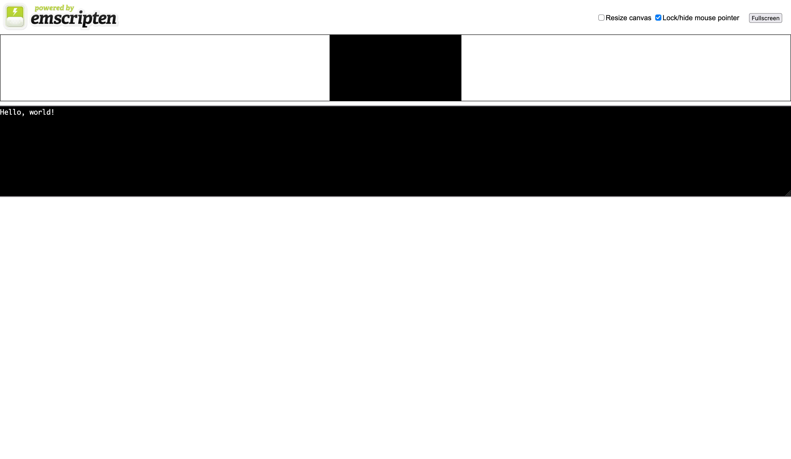

# SwiftのEmscriptenサポートを試す

Swiftでは今年に入ってから、[@MaxDesiatov](https://github.com/MaxDesiatov)氏による一連のEmscripten対応PRがマージされている。Swiftコンパイラのビルドが重たく試せていなかったが、Swift+EmscriptenでHello Worldできることがわかったので、その手順をまとめておく。

## 環境

- macOS 26.4.1
- Swift `351cec786dcd1138616635b9000a0ef37c4f5101`
- Homebrew 7.0.10-65-g786fc9e

## Swiftをビルドする

Swiftには[Swift SDK for WebAssembly](https://www.swift.org/documentation/articles/wasm-getting-started.html)が存在するが、これにはEmscriptenターゲットが含まれていないようなので、自分でビルドする。

Emscriptenターゲットのみビルドすることも可能なようだが、Swiftのバージョンと合わせたいので今回はSwiftごとビルドする。

ビルド方法は、基本的には公式のドキュメントに従う:

- [GettingStarted.md](https://github.com/swiftlang/swift/blob/main/docs/HowToGuides/GettingStarted.md)
- [WebAssembly.md](https://github.com/swiftlang/swift/blob/main/docs/WebAssembly.md)

リポジトリをクローンする:

```
% git clone https://github.com/swiftlang/swift
% cd swift
% utils/update-checkout --clone
```

Python 3、Ninja、Emscriptenが入っていることを確認する。sccacheはオプショナルであるが、今回は使用するという前提:

```
% python3 --version
Python 3.11.9
% ninja --version
1.12.1
% sccache --version
sccache 0.16.0
% emcc --version
emcc (Emscripten gcc/clang-like replacement + linker emulating GNU ld) 6.0.13-git
Copyright (C) 2026 the Emscripten authors (see AUTHORS.txt)
This is free and open source software under the MIT license.
There is NO warranty; not even for MERCHANTABILITY or FITNESS FOR A PARTICULAR PURPOSE.
```

Emscripten対応でビルドするには、`--build-emscripten-stdlib`をつけてビルドする。`--emscripten-path`で、Emscriptenのパスを指定する:

```
% utils/build-script \
  --swift-darwin-supported-archs "$(uname -m)" \
  --release-debuginfo \
  --swift-disable-dead-stripping \
  --sccache \
  --build-emscripten-stdlib \
  --emscripten-path "$(brew --prefix emscripten)/libexec" \
  --skip-test-emscripten-stdlib \
  --install-swift \
  --install-llvm
```

M1 Proで大体1時間くらいかかった。また、ソースコードと成果物あわせて100GBほどディスクを占有するので注意。

ビルドでハマった点:

- ビルドディレクトリのパスに、空白文字が含まれていると落ちる
  - 日本語も含まれていない方が無難
- Emscriptenのバージョンが古いと落ちる
  - 元々`4.0.8`を使っていた。ドキュメントでは`5.0.2`が使われているので、これより新しければ良さそう

## ブラウザ向けにビルドする

ビルドしたバイナリを使って、Hello WorldプログラムをEmscripten向けにビルドする。

表記を簡略化するため、ビルドしたSwiftコンパイラのパスを環境変数に設定する:

```
% export SWIFT_EXEC=.../build/Ninja-RelWithDebInfoAssert/toolchain-macosx-arm64/Applications/Xcode.app/Contents/Developer/Toolchains/XcodeDefault.xctoolchain/usr/bin/swiftc # ビルドしたSwiftコンパイラ
% export SDK_BUNDLE=.../swift-sdk-generator/Bundles/swift-DEVELOPMENT-SNAPSHOT_wasm.artifactbundle # Swift Emscripten SDK
% export SDK_STORE=... # SDKを保存するディレクトリ。今回は、ホスト側のSwiftと異なる場所に保存する。どこでも良い
% export SDK_ID=swift-DEVELOPMENT-SNAPSHOT_wasm-emscripten
```

まず、SDKをインストールする:

```
% swift sdk install "$SDK_BUNDLE" --swift-sdks-path "$SDK_STORE"
```

`swift-DEVELOPMENT-SNAPSHOT_wasm-emscripten`が認識されていることを確認する:

```
% swift sdk list --swift-sdks-path "$SDK_STORE"
swift-DEVELOPMENT-SNAPSHOT_wasm-emscripten
swift-DEVELOPMENT-SNAPSHOT_wasm-emscripten-embedded
```

適当なプロジェクトを初期化する:

```
% mkdir swift-emscripten
% cd swift-emscripten
% swift package init --type executable
```

`Sources/main.swift`はこうなっているはず:

```swift
// The Swift Programming Language
// https://docs.swift.org/swift-book

@main
struct swift_emscripten {
    static func main() {
        print("Hello, world!")
    }
}
```

SDKを指定して、このままビルドしてみる:

```
% swift build \
  --swift-sdks-path "$SDK_STORE" \
  --swift-sdk "$SDK_ID" \
  -Xswiftc -Xlinker-driver \
  -Xswiftc=-sDEFAULT_TO_CXX=1 \
  -v
```

何事もなければ、`.wasm`形式で出力される。が、このままだと実行できない:

```
% ls ./.build/wasm32-unknown-emscripten/debug 
ModuleCache                                     swift-emscripten.wasm                           swift_emscriptenPackageTests.build
description.json                                swift-version-6AC4106290256C38.txt              swift_emscriptenTests.build
index                                           swift_emscripten.build
swift-emscripten.product                        swift_emscriptenPackageDiscoveredTests.build
```

Emscripten自体は、実行可能な`.js`、`.html`の生成に対応しているものの、`swift`コマンド経由ではこれらはおそらく使用できない。そこで、先ほどの`swift -v`が出力した`swiftc`の呼び出しを改変し、`-o`を`.html`に差し替えて、HTMLを生成する。先ほどの`swift`コマンドのビルド成果物があることが前提である。

実際のコマンドはSwiftのバージョンによって変化する可能性があるので、`swift -v`の出力結果を元に書き換えることを推奨。

```
% export BUILD_DIR=.../.build/wasm32-unknown-emscripten/debug
% export EMSDK_ROOT="$SDK_STORE/swift-DEVELOPMENT-SNAPSHOT_wasm.artifactbundle/swift-DEVELOPMENT-SNAPSHOT_wasm-emscripten/wasm32-unknown-emscripten"
% "$SWIFT_EXEC" \
  -L "$BUILD_DIR" \
  -o "$BUILD_DIR/swift-emscripten.html" \
  -module-name swift_emscripten \
  -emit-executable \
  -resource-dir "$EMSDK_ROOT/swift.xctoolchain/usr/lib/swift_static" \
  -Xlinker-driver -sDEFAULT_TO_CXX=1 \
  "$BUILD_DIR/swift_emscripten.build/main.swift.o" \
  "$BUILD_DIR/swift_emscripten.build/swift_emscripten.swiftmodule.o" \
  -target wasm32-unknown-emscripten \
  -static-stdlib \
  -tools-directory "$EMSDK_ROOT/swift.xctoolchain/usr/bin" \
  -sdk "$EMSDK_ROOT/Emscripten.sdk" \
  -v
```

うまくいけば、`.html`が生成される:

```
% ls ./.build/wasm32-unknown-emscripten/debug 
ModuleCache                                     swift-emscripten.js                             swift_emscripten.build
description.json                                swift-emscripten.product                        swift_emscriptenPackageDiscoveredTests.build
index                                           swift-emscripten.wasm                           swift_emscriptenPackageTests.build
swift-emscripten.html                           swift-version-6AC4106290256C38.txt              swift_emscriptenTests.build
```

`serve`等のサーバーを起動し、ブラウザで開くと、`Hello, world!`が表示されるはず。



## 参考

- [\[Pitch\] Emscripten Target Support for Swift - Platform / Swift for WebAssembly - Swift Forums](https://forums.swift.org/t/pitch-emscripten-target-support-for-swift/85310)
- [swift/docs/HowToGuides/GettingStarted.md at main · swiftlang/swift](https://github.com/swiftlang/swift/blob/main/docs/HowToGuides/GettingStarted.md)
- [swift/docs/WebAssembly.md at main · swiftlang/swift](https://github.com/swiftlang/swift/blob/main/docs/WebAssembly.md)
- [Disable C++ linking (DEFAULT_TO_CXX) by default by sbc100 · Pull Request #27469 · emscripten-core/emscripten](https://github.com/emscripten-core/emscripten/pull/27469)